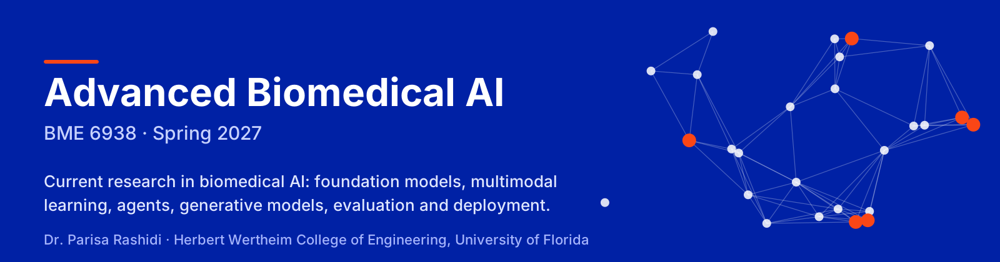
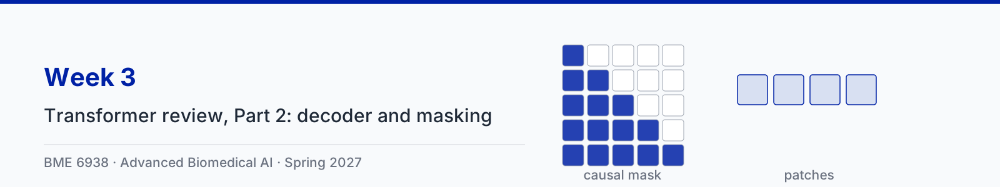
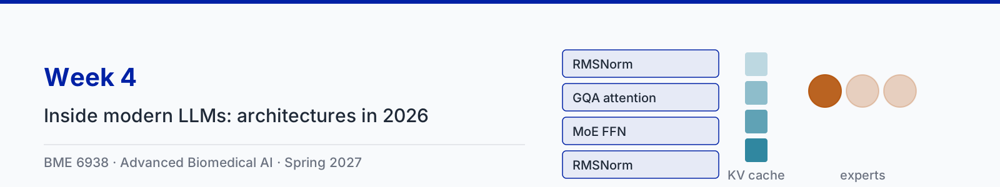
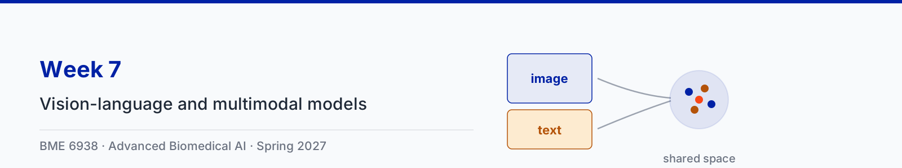
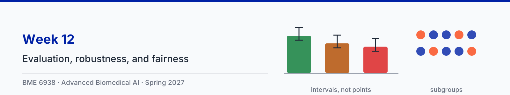

# Advanced Biomedical AI (BME 6938)

University of Florida, J. Crayton Pruitt Family Department of Biomedical Engineering, Spring 2027

**Instructor:** Dr. Parisa Rashidi

**Meetings:** Tuesdays 1:55-2:45 PM (Period 7) and Thursdays 1:55-3:50 PM (Periods 7-8), Black Hall BLK 0315

A graduate course on current research in biomedical AI: modern LLM architectures, post-training and reasoning, self-supervised representation learning, foundation models for imaging, EHR, and physiological time series, vision-language and multimodal models, retrieval and agentic systems, generative models, clinical evaluation, robustness and fairness, and deployment.

## How the course works

| Session | What happens |
|---|---|
| Tuesday lecture | Instructor mini-lecture on the core concept of the week with short animation clips, and a preview of the papers for Thursday |
| Thursday paper sessions | Two papers, one per period. Each has a presentation group (20 min), a critique group (15 min), and class discussion (15 min) |
| Reading responses | One paragraph and one discussion question per paper, due by 1:00 PM Thursday |
| Term project | Teams of three write a research paper on an open problem in biomedical AI |
| Week 1 | Tuesday is course logistics. Thursday covers how to read, present, and critique a paper, followed by an instructor-led model paper session |
| Weeks 2 and 3 | The Tuesday lectures review the transformer architecture in two parts; student paper sessions start on the Thursday of Week 2 |
| Final two weeks | Reserved for project presentations: no lectures or paper sessions |

## Course map

Every week of the course. Click a week for its slides, clips, and notebook.

Slides: [1-1](lectures/week01/slides/1-1-course-logistics.pdf) · [1-2](lectures/week01/slides/1-2-reading-presenting-critiquing-papers.pdf)

[Slides (PDF)](lectures/week02/slides/2-1-transformer-review-part-1.pdf) · [5 clips](lectures/week02/) · [Part 1 notebook](lectures/notebooks/week02_transformer_review_part1.ipynb) · [Open in Colab](https://colab.research.google.com/github/parisar/BME6938-Advanced-Biomedical-AI-Spring-2027/blob/main/lectures/notebooks/week02_transformer_review_part1.ipynb)

[Slides (PDF)](lectures/week03/slides/3-1-transformer-review-part-2.pdf) · [3 clips](lectures/week03/) · [Part 2 notebook](lectures/notebooks/week03_transformer_review_part2.ipynb) · [Open in Colab](https://colab.research.google.com/github/parisar/BME6938-Advanced-Biomedical-AI-Spring-2027/blob/main/lectures/notebooks/week03_transformer_review_part2.ipynb)

[Slides (PDF)](lectures/week04/slides/4-1-inside-modern-llms.pdf) · [4 clips](lectures/week04/) · [Week 4 notebook](lectures/notebooks/week04_modern_llms.ipynb) · [Open in Colab](https://colab.research.google.com/github/parisar/BME6938-Advanced-Biomedical-AI-Spring-2027/blob/main/lectures/notebooks/week04_modern_llms.ipynb)

[Slides (PDF)](lectures/week05/slides/5-1-post-training-and-reasoning.pdf) · [4 clips](lectures/week05/) · [Week 5 notebook](lectures/notebooks/week05_post_training.ipynb) · [Open in Colab](https://colab.research.google.com/github/parisar/BME6938-Advanced-Biomedical-AI-Spring-2027/blob/main/lectures/notebooks/week05_post_training.ipynb)

[Slides (PDF)](lectures/week06/slides/6-1-self-supervised-learning-and-imaging-foundation-models.pdf) · [3 clips](lectures/week06/) · [Week 6 notebook](lectures/notebooks/week06_self_supervised_learning.ipynb) · [Open in Colab](https://colab.research.google.com/github/parisar/BME6938-Advanced-Biomedical-AI-Spring-2027/blob/main/lectures/notebooks/week06_self_supervised_learning.ipynb)

[Slides (PDF)](lectures/week07/slides/7-1-vision-language-and-multimodal-models.pdf) · [3 clips](lectures/week07/) · [Week 7 notebook](lectures/notebooks/week07_vision_language.ipynb) · [Open in Colab](https://colab.research.google.com/github/parisar/BME6938-Advanced-Biomedical-AI-Spring-2027/blob/main/lectures/notebooks/week07_vision_language.ipynb)

[Slides (PDF)](lectures/week08/slides/8-1-foundation-models-for-ehr-and-time-series.pdf) · [3 clips](lectures/week08/) · [Week 8 notebook](lectures/notebooks/week08_ehr_time_series.ipynb) · [Open in Colab](https://colab.research.google.com/github/parisar/BME6938-Advanced-Biomedical-AI-Spring-2027/blob/main/lectures/notebooks/week08_ehr_time_series.ipynb)

[Slides (PDF)](lectures/week09/slides/9-1-retrieval-tool-use-and-agentic-systems.pdf) · [3 clips](lectures/week09/) · [Week 9 notebook](lectures/notebooks/week09_retrieval_agents.ipynb) · [Open in Colab](https://colab.research.google.com/github/parisar/BME6938-Advanced-Biomedical-AI-Spring-2027/blob/main/lectures/notebooks/week09_retrieval_agents.ipynb)

[Slides (PDF)](lectures/week11/slides/11-1-generative-models-and-ai-for-science.pdf) · [3 clips](lectures/week11/) · [Week 11 notebook](lectures/notebooks/week11_diffusion.ipynb) · [Open in Colab](https://colab.research.google.com/github/parisar/BME6938-Advanced-Biomedical-AI-Spring-2027/blob/main/lectures/notebooks/week11_diffusion.ipynb)

[Slides (PDF)](lectures/week12/slides/12-1-evaluation-robustness-and-fairness.pdf) · [3 clips](lectures/week12/) · [Week 12 notebook](lectures/notebooks/week12_evaluation.ipynb) · [Open in Colab](https://colab.research.google.com/github/parisar/BME6938-Advanced-Biomedical-AI-Spring-2027/blob/main/lectures/notebooks/week12_evaluation.ipynb)

[Slides (PDF)](lectures/week13/slides/13-1-deployment-and-human-ai-teaming.pdf) · [3 clips](lectures/week13/) · [Week 13 notebook](lectures/notebooks/week13_deployment.ipynb) · [Open in Colab](https://colab.research.google.com/github/parisar/BME6938-Advanced-Biomedical-AI-Spring-2027/blob/main/lectures/notebooks/week13_deployment.ipynb)
## Where things are

| Folder | Contents |
|---|---|
| [syllabus/](syllabus/) | Course syllabus |
| [papers/](papers/) | Reading list with links to every assigned paper |
| [presentations/](presentations/) | Paper presentation and critique rubric, reading response guidelines |
| [project/](project/) | Term project guidelines, milestones, rubric, suggested problems, templates |
| [lectures/](lectures/) | Slides, animation clips, and code notebooks, posted weekly |

Submissions, grades, and announcements are on Canvas.

**Deadlines.** Reading responses are due at 1:00 PM on Thursday and the survey locks then. Written work is due at 11:59 PM on the stated day. Anything presented in class is due at 1:00 PM that day, except the slides for a Thursday paper session, which are due at 12:00 PM so that both sessions can be loaded onto the room computer before class. Late work loses 5% per late day unless the assignment says otherwise.

## Schedule

| Week | Topic | Thursday papers | Project |
|---|---|---|---|
| 1 | Course logistics; how to read, present, and critique papers | Model session: [Moor et al.: GMAI](https://doi.org/10.1038/s41586-023-05881-4) | Paper and group assignments posted on Canvas by Fri Jan 15. Start data-access training (MIMIC credentialing). |
| 2 | Transformer review, Part 1: attention and the encoder | [Devlin et al.: BERT](https://aclanthology.org/N19-1423/) [Yang et al.: GatorTron](https://doi.org/10.1038/s41746-022-00742-2) |  |
| 3 | Transformer review, Part 2: decoder, masking, and model families | [Luo et al.: BioGPT](https://doi.org/10.1093/bib/bbac409) [Dosovitskiy et al.: ViT](https://arxiv.org/abs/2010.11929) | Teams formed (Thu Jan 28) |
| 4 | Inside modern LLMs: architectures in 2026 | [DeepSeek-AI: DeepSeek-V3](https://arxiv.org/abs/2412.19437) [Sellergren et al.: MedGemma](https://arxiv.org/abs/2507.05201) |  |
| 5 | Post-training and reasoning: from pretrained model to clinical assistant | [Guo et al.: DeepSeek-R1](https://doi.org/10.1038/s41586-025-09422-z) [Singhal et al.: Med-PaLM 2](https://doi.org/10.1038/s41591-024-03423-7) |  |
| 6 | Self-supervised learning and imaging foundation models | [He et al.: MAE](https://arxiv.org/abs/2111.06377) [Chen et al.: UNI](https://doi.org/10.1038/s41591-024-02857-3) | Proposal due Fri Feb 19, 11:59 PM |
| 7 | Vision-language and multimodal models | [Radford et al.: CLIP](https://proceedings.mlr.press/v139/radford21a.html) [Tu et al.: Med-PaLM M](https://doi.org/10.1056/AIoa2300138) | Pitch slide due 1:00 PM Tue Feb 23; 2-min pitches in class; peer reviews assigned |
| 8 | Foundation models for EHR and physiological time series | [Wornow et al.: Shaky foundations of EHR foundation models](https://doi.org/10.1038/s41746-023-00879-8) [Renc et al.: ETHOS](https://doi.org/10.1038/s41746-024-01235-0) | Peer reviews due Thu Mar 4, 11:59 PM |
| 9 | Retrieval, tool use, and agentic systems | [Yao et al.: ReAct](https://arxiv.org/abs/2210.03629) [Zakka et al.: Almanac](https://doi.org/10.1056/AIoa2300068) |  |
| 10 | Spring break | No class |  |
| 11 | Generative models and AI for science | [Watson et al.: RFdiffusion](https://doi.org/10.1038/s41586-023-06415-8) [Abramson et al.: AlphaFold 3](https://doi.org/10.1038/s41586-024-07487-w) | Progress report due Fri Mar 26, 11:59 PM |
| 12 | Evaluation, robustness, and fairness | [Goh et al.: LLMs and diagnostic reasoning: an RCT](https://doi.org/10.1001/jamanetworkopen.2024.40969) [DeGrave et al.: COVID-19 shortcuts](https://doi.org/10.1038/s42256-021-00338-7) |  |
| 13 | Deployment, human-AI teaming, and ambient intelligence | [Wong et al.: External validation of a sepsis model](https://doi.org/10.1001/jamainternmed.2021.2626) [Haque et al.: Ambient intelligence](https://doi.org/10.1038/s41586-020-2669-y) |  |
| 14 | Final project presentations | Final project presentations (Tuesday and Thursday) | Final presentations Tue Apr 13 (3 teams) and Thu Apr 15 (5 teams); every team's slides due 1:00 PM Tue Apr 13 |
| 15 | Final project presentations and wrap-up | Final project presentations (Tuesday) | Final presentations Tue Apr 20 (2 teams); paper and repository due Wed Apr 21, 11:59 PM |

Full citations and links are in [papers/](papers/).

## Grading

| Component | Percentage |
|---|---|
| Paper presentations and critiques | 40% |
| Reading responses and participation | 20% |
| Project proposal | 5% |
| Project progress report | 5% |
| Final project presentation | 10% |
| Final project paper and repository | 20% |

## Prerequisites

BME 6938 Medical Artificial Intelligence (Fundamentals of Biomedical AI) or an equivalent machine learning or deep learning course, and proficiency in Python. The transformer architecture is reviewed in Weeks 2 and 3.

## License

Code (tools, notebooks, and animation source) is licensed under the [Apache License 2.0](LICENSE). Course content (text, notebook explanations, and animation clips) is licensed under [CC BY 4.0](LICENSE-CONTENT.md). Third-party material keeps its own license: the Kather H&E tiles (CC BY 4.0) and the Inter font (SIL Open Font License) are credited where used, and notebook code adapted from Sebastian Raschka's LLMs-from-scratch keeps its Apache 2.0 notice.
