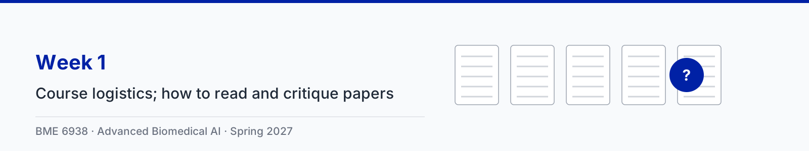

# Week 1: Course introduction

| Session | Content |
|---|---|
| Tue Jan 12 | Course logistics: how the course works, grading, the term project, and how to get started |
| Thu Jan 14 | Period 7: how to read, present, and critique a paper. Period 8: an instructor-led model paper session on [Moor et al., Foundation models for generalist medical artificial intelligence](https://doi.org/10.1038/s41586-023-05881-4) |

Slides: [1-1 Course logistics (PDF)](slides/1-1-course-logistics.pdf), [1-2 Reading, presenting, and critiquing papers (PDF)](slides/1-2-reading-presenting-critiquing-papers.pdf)

There are no animation clips or a notebook this week; both start in Week 2.

The plan for the Thursday session, including what the model presentation and critique are meant to show, is in
[thursday_session.md](thursday_session.md).

## What to do this week

- Read Moor et al. before Thursday. No reading response is due for it; responses start in Week 2.
- Paper and group assignments are posted on Canvas by Friday, January 15.
- If you may use credentialed data (MIMIC-IV, MIMIC-CXR, eICU), start CITI training now: credentialing can take
  several weeks. See [project/starter_kits.md](../../project/starter_kits.md).
