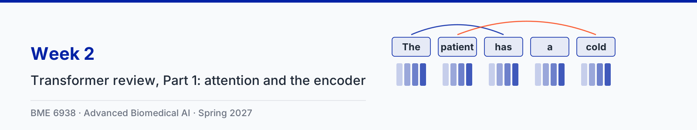

# Week 2: Transformer review, Part 1: attention and the encoder

| Session | Content |
|---|---|
| Tue Jan 19 | Transformer review, Part 1, with five animation clips |
| Thu Jan 21 | Paper sessions: [Devlin et al., BERT: Pre-training of Deep Bidirectional Transformers for Language Understanding](https://aclanthology.org/N19-1423/) and [Yang et al., A large language model for electronic health records (GatorTron)](https://doi.org/10.1038/s41746-022-00742-2) |

Slides: [2-1 slides (PDF)](slides/2-1-transformer-review-part-1.pdf)

## Animation clips

The running example is the sentence "The patient has a cold" (clip 3 also contrasts "chest pain, no pressure" with "no pain, chest pressure"), with the same numbers as the slides. Each clip comes in two versions: narrated (voice-over plus on-screen captions) and silent (captions only).

| Clip | Narrated | Silent |
|---|---|---|
| 1. From tokens to vectors | [1 min 27 s](clips/narrated/week02-clip1-tokens-to-vectors-narrated.mp4) | [59 s](clips/silent/week02-clip1-tokens-to-vectors.mp4) |
| 2. Attention for one token | [1 min 10 s](clips/narrated/week02-clip2-attention-one-token-narrated.mp4) | [55 s](clips/silent/week02-clip2-attention-one-token.mp4) |
| 3. Giving tokens a position | [1 min 42 s](clips/narrated/week02-clip3-positions-narrated.mp4) | [1 min 2 s](clips/silent/week02-clip3-positions.mp4) |
| 4. Relative positions: RoPE and ALiBi | [2 min 42 s](clips/narrated/week02-clip4-relative-positions-narrated.mp4) | [56 s](clips/silent/week02-clip4-relative-positions.mp4) |
| 5. Inside the encoder block | [1 min 14 s](clips/narrated/week02-clip5-encoder-block-narrated.mp4) | [54 s](clips/silent/week02-clip5-encoder-block.mp4) |

The narration is an AI-generated voice reading a script written for the course. Captions for the narrated clips are in a WebVTT file beside each video (`clips/narrated/*.vtt`), which covers WCAG 2.1 criterion 1.2.2; players that read sidecar subtitle files, such as VLC, load them automatically. The source code for the clips is in [animations/](animations/) and the narration script is in [clips.json](clips.json).

## Transcripts

Each clip also has a plain-text transcript of its narration in [clips/transcripts/](clips/transcripts/). The transcript is the text alternative for the silent version, which has no audio track at all (WCAG 2.1 criterion 1.2.1), and it is the quickest way to review what a clip says when revising.

| Clip | Transcript |
|---|---|
| 1. From tokens to vectors | [week02-clip1-tokens-to-vectors.md](clips/transcripts/week02-clip1-tokens-to-vectors.md) |
| 2. Attention for one token | [week02-clip2-attention-one-token.md](clips/transcripts/week02-clip2-attention-one-token.md) |
| 3. Giving tokens a position | [week02-clip3-positions.md](clips/transcripts/week02-clip3-positions.md) |
| 4. Relative positions: RoPE and ALiBi | [week02-clip4-relative-positions.md](clips/transcripts/week02-clip4-relative-positions.md) |
| 5. Inside the encoder block | [week02-clip5-encoder-block.md](clips/transcripts/week02-clip5-encoder-block.md) |

## Notebook

The ungraded reference notebook for this lecture is [week02_transformer_review_part1.ipynb](../notebooks/week02_transformer_review_part1.ipynb).
