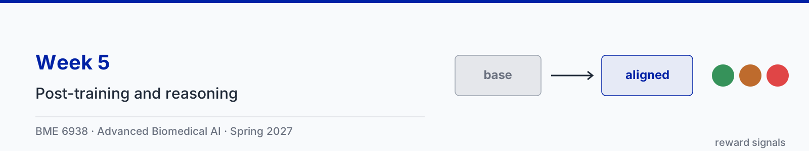

# Week 5: Post-training and reasoning: from pretrained model to clinical assistant

| Session | Content |
|---|---|
| Tue Feb 9 | Post-training and reasoning, with four animation clips |
| Thu Feb 11 | Paper sessions: [Guo et al., DeepSeek-R1](https://doi.org/10.1038/s41586-025-09422-z) and [Singhal et al., Med-PaLM 2](https://doi.org/10.1038/s41591-024-03423-7) |

Slides: [5-1 slides (PDF)](slides/5-1-post-training-and-reasoning.pdf)

## Animation clips

The running example continues Week 4: the note "The patient denies chest pain" and the question "Does the patient report chest pain?", which the post-trained Qwen3-0.6B answers wrongly. The model outputs, log-probabilities, and token counts in the clips are real outputs of Qwen3-0.6B-Base and Qwen3-0.6B (greedy decoding, 32-bit, CPU), reproduced in the notebook. The thinking text in clip 4, segment 1, the DPO gains of +4 and −6, and the four GRPO samples are illustrative. Each clip comes in two versions: narrated (voice-over plus on-screen captions) and silent (captions only).

| Clip | Narrated | Silent |
|---|---|---|
| 1. From pretrained model to clinical assistant | [1 min 40 s](clips/narrated/week05-clip1-post-training-narrated.mp4) | [50 s](clips/silent/week05-clip1-post-training.mp4) |
| 2. LoRA: fine-tuning with a small fraction of the weights | [1 min 45 s](clips/narrated/week05-clip2-lora-narrated.mp4) | [51 s](clips/silent/week05-clip2-lora.mp4) |
| 3. Preference tuning: RLHF and DPO | [1 min 56 s](clips/narrated/week05-clip3-preference-tuning-narrated.mp4) | [48 s](clips/silent/week05-clip3-preference-tuning.mp4) |
| 4. Reasoning models | [2 min 31 s](clips/narrated/week05-clip4-reasoning-narrated.mp4) | [1 min](clips/silent/week05-clip4-reasoning.mp4) |

The narration is an AI-generated voice reading a script written for the course. Captions for the narrated clips are in a WebVTT file beside each video (`clips/narrated/*.vtt`), which covers WCAG 2.1 criterion 1.2.2; players that read sidecar subtitle files, such as VLC, load them automatically. The source code for the clips is in [animations/](animations/) and the narration script is in [clips.json](clips.json).

**Note for the lecture (clip 3).** Preference data that always rewards the more cautious answer can teach a model to hedge on everything ("further assessment is recommended") instead of answering. Good clinical preference data rewards the answer that is correct and useful, and includes cases where the confident answer is the right one.

## Transcripts

Each clip also has a plain-text transcript of its narration in [clips/transcripts/](clips/transcripts/). The transcript is the text alternative for the silent version, which has no audio track at all (WCAG 2.1 criterion 1.2.1), and it is the quickest way to review what a clip says when revising.

| Clip | Transcript |
|---|---|
| 1. From pretrained model to clinical assistant | [week05-clip1-post-training.md](clips/transcripts/week05-clip1-post-training.md) |
| 2. LoRA: fine-tuning with a small fraction of the weights | [week05-clip2-lora.md](clips/transcripts/week05-clip2-lora.md) |
| 3. Preference tuning: RLHF and DPO | [week05-clip3-preference-tuning.md](clips/transcripts/week05-clip3-preference-tuning.md) |
| 4. Reasoning models | [week05-clip4-reasoning.md](clips/transcripts/week05-clip4-reasoning.md) |

## Notebook

The ungraded reference notebook for this lecture is [week05_post_training.ipynb](../notebooks/week05_post_training.ipynb). It
compares Qwen3-0.6B-Base with Qwen3-0.6B, writes LoRA, the masked fine-tuning loss, the DPO loss, and the GRPO advantage from
scratch, and trains small LoRA adapters that fix the negation error. It runs on Colab or HiPerGator, on CPU or GPU. The code
follows Sebastian Raschka's [LLMs-from-scratch](https://github.com/rasbt/LLMs-from-scratch) and
[reasoning-from-scratch](https://github.com/rasbt/reasoning-from-scratch) (both Apache 2.0).

## Further reading

- Raschka, [LLM Training: RLHF and Its Alternatives](https://magazine.sebastianraschka.com/p/llm-training-rlhf-and-its-alternatives), Ahead of AI
- Raschka, [Understanding Reasoning LLMs](https://magazine.sebastianraschka.com/p/understanding-reasoning-llms), Ahead of AI, 2025
- Raschka, [The State of Reinforcement Learning for LLM Reasoning](https://magazine.sebastianraschka.com/p/the-state-of-llm-reasoning-model-training), Ahead of AI, 2025
- Hu et al., [LoRA: Low-Rank Adaptation of Large Language Models](https://arxiv.org/abs/2106.09685), ICLR, 2022
- Rafailov et al., [Direct Preference Optimization](https://arxiv.org/abs/2305.18290), NeurIPS, 2023
- Shao et al., [DeepSeekMath](https://arxiv.org/abs/2402.03300), 2024: introduces GRPO
