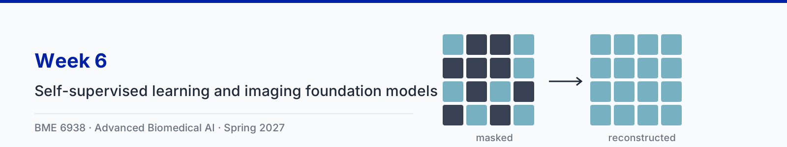

# Week 6: Self-supervised learning and imaging foundation models

| Session | Content |
|---|---|
| Tue Feb 16 | Self-supervised representation learning, with three animation clips |
| Thu Feb 18 | Paper sessions: [He et al., Masked Autoencoders Are Scalable Vision Learners](https://arxiv.org/abs/2111.06377) and [Chen et al., Towards a general-purpose foundation model for computational pathology (UNI)](https://doi.org/10.1038/s41591-024-02857-3) |

Slides: [6-1 slides (PDF)](slides/6-1-self-supervised-learning-and-imaging-foundation-models.pdf)

## Animation clips

The running examples are a single-lead ECG and H&E pathology tiles. The ECG is synthetic, generated in code. The tiles are real colorectal tissue from an open dataset ([Kather et al. 2016](https://doi.org/10.5281/zenodo.53169), CC BY 4.0). Each clip comes in two versions: narrated (voice-over plus on-screen captions) and silent (captions only).

| Clip | Narrated | Silent |
|---|---|---|
| 1. Masked reconstruction: learning by filling in gaps | [1 min 35 s](clips/narrated/week06-clip1-masked-reconstruction-narrated.mp4) | [57 s](clips/silent/week06-clip1-masked-reconstruction.mp4) |
| 2. Contrastive learning: two views, one embedding | [1 min 40 s](clips/narrated/week06-clip2-contrastive-learning-narrated.mp4) | [58 s](clips/silent/week06-clip2-contrastive-learning.mp4) |
| 3. Linear probing: what did the encoder learn? | [1 min 25 s](clips/narrated/week06-clip3-linear-probing-narrated.mp4) | [49 s](clips/silent/week06-clip3-linear-probing.mp4) |

The narration is an AI-generated voice reading a script written for the course. Captions for the narrated clips are in a WebVTT file beside each video (`clips/narrated/*.vtt`), which covers WCAG 2.1 criterion 1.2.2; players that read sidecar subtitle files, such as VLC, load them automatically. The source code for the clips is in [animations/](animations/) and the narration script is in [clips.json](clips.json).

## Transcripts

Each clip also has a plain-text transcript of its narration in [clips/transcripts/](clips/transcripts/). The transcript is the text alternative for the silent version, which has no audio track at all (WCAG 2.1 criterion 1.2.1), and it is the quickest way to review what a clip says when revising.

| Clip | Transcript |
|---|---|
| 1. Masked reconstruction: learning by filling in gaps | [week06-clip1-masked-reconstruction.md](clips/transcripts/week06-clip1-masked-reconstruction.md) |
| 2. Contrastive learning: two views, one embedding | [week06-clip2-contrastive-learning.md](clips/transcripts/week06-clip2-contrastive-learning.md) |
| 3. Linear probing: what did the encoder learn? | [week06-clip3-linear-probing.md](clips/transcripts/week06-clip3-linear-probing.md) |

## Notebook

The ungraded reference notebook for this lecture is [week06_self_supervised_learning.ipynb](../notebooks/week06_self_supervised_learning.ipynb). It
follows the three clips step by step with the same running examples: the synthetic ECG from the clip generator (10 one-second
patches, 6 hidden) and the Kather 2016 H&E tiles (12 of 16 patches hidden). It pretrains small masked-reconstruction and
contrastive encoders without labels, then compares them with random encoders of the same architecture under a linear probe
(257 trainable weights) and under fine-tuning, for AF versus normal rhythm and for tumor versus normal mucosa. It runs on
Colab or HiPerGator on CPU in about 12 minutes.
