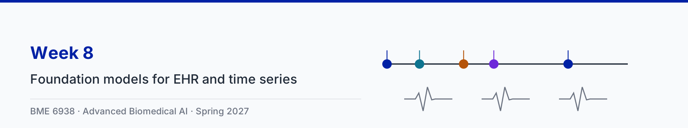

# Week 8: Foundation models for EHR and physiological time series

| Session | Content |
|---|---|
| Tue Mar 2 | Foundation models for EHR and physiological time series, with three animation clips |
| Thu Mar 4 | Paper sessions: [Wornow et al., The shaky foundations of large language models and foundation models for electronic health records](https://doi.org/10.1038/s41746-023-00879-8) and [Renc et al., Zero shot health trajectory prediction using transformer (ETHOS)](https://doi.org/10.1038/s41746-024-01235-0) |

Slides: [8-1 slides (PDF)](slides/8-1-foundation-models-for-ehr-and-time-series.pdf)

## Animation clips

The running example is one synthetic ICU patient (no real patient data): ED admission at 0 h, lactate 4.1 mmol/L at 0.6 h, norepinephrine at 1.5 h, sepsis (A41.9) at 2.2 h, and ICU transfer at 3.5 h. The tokenization rules and the results in clips 1 and 2 follow ETHOS and were checked against both the arXiv preprint and the published article. The 20 rollouts, the false-alarm example, the quantile cutoffs, and the ICU-day values in clip 3 are illustrative. Each clip comes in two versions: narrated (voice-over plus on-screen captions) and silent (captions only).

| Clip | Narrated | Silent |
|---|---|---|
| 1. A patient timeline as tokens | [1 min 38 s](clips/narrated/week08-clip1-timeline-tokens-narrated.mp4) | [43 s](clips/silent/week08-clip1-timeline-tokens.mp4) |
| 2. Zero-shot prediction by simulating the future | [2 min 2 s](clips/narrated/week08-clip2-rollouts-narrated.mp4) | [52 s](clips/silent/week08-clip2-rollouts.mp4) |
| 3. Irregular sampling and physiological signals | [1 min 46 s](clips/narrated/week08-clip3-irregular-signals-narrated.mp4) | [51 s](clips/silent/week08-clip3-irregular-signals.mp4) |

The narration is an AI-generated voice reading a script written for the course. Captions for the narrated clips are in a WebVTT file beside each video (`clips/narrated/*.vtt`), which covers WCAG 2.1 criterion 1.2.2; players that read sidecar subtitle files, such as VLC, load them automatically. The source code for the clips is in [animations/](animations/) and the narration script is in [clips.json](clips.json). The storyboard brief is in [storyboard.md](storyboard.md).

**Note for the lecture (clip 2).** The ETHOS baselines are numbers reported by other studies, which the authors note used their own exclusion criteria and often no public code; they were not re-run on the ETHOS test set. MIMIC-IV comes from one hospital, and ETHOS keeps only the most recent 2,048 tokens, so dense records lose their earliest history.

## Transcripts

Each clip also has a plain-text transcript of its narration in [clips/transcripts/](clips/transcripts/). The transcript is the text alternative for the silent version, which has no audio track at all (WCAG 2.1 criterion 1.2.1), and it is the quickest way to review what a clip says when revising.

| Clip | Transcript |
|---|---|
| 1. A patient timeline as tokens | [week08-clip1-timeline-tokens.md](clips/transcripts/week08-clip1-timeline-tokens.md) |
| 2. Zero-shot prediction by simulating the future | [week08-clip2-rollouts.md](clips/transcripts/week08-clip2-rollouts.md) |
| 3. Irregular sampling and physiological signals | [week08-clip3-irregular-signals.md](clips/transcripts/week08-clip3-irregular-signals.md) |

## Notebook

The ungraded reference notebook for this lecture is [week08_ehr_time_series.ipynb](../notebooks/week08_ehr_time_series.ipynb). It
builds a small ETHOS from scratch on synthetic ICU stays: the tokenizer (the clip's patient becomes the same 19 tokens), a tiny
decoder trained with the next-token loss, 20 rollouts per patient turned into a probability and an AUC (compared with the
AUC of the true synthetic risk), a false-alarm count, an hourly grid with a mask, interval tokens, the time embedding, and ECG
patches at 500 Hz. An optional section downloads the open MIMIC-IV Clinical Database Demo at run time (ODbL v1.0) and
tokenizes its lactate values; those files are never stored in the repository. It runs on CPU in about a minute.

## Further reading

- Renc et al., [Zero shot health trajectory prediction using transformer](https://doi.org/10.1038/s41746-024-01235-0), npj Digital Medicine, 2024 ([arXiv](https://arxiv.org/abs/2407.21124))
- Wornow et al., [The shaky foundations of large language models and foundation models for electronic health records](https://doi.org/10.1038/s41746-023-00879-8), npj Digital Medicine, 2023
- Johnson et al., [MIMIC-IV Clinical Database Demo](https://doi.org/10.13026/dp1f-ex47), PhysioNet, 2023
