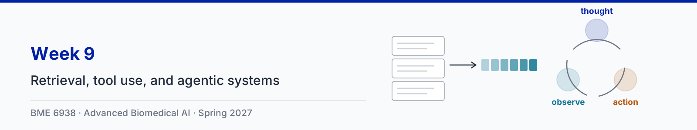

# Week 9: Retrieval, tool use, and agentic systems

| Session | Content |
|---|---|
| Tue Mar 9 | Retrieval, tool use, and agentic systems, with three animation clips |
| Thu Mar 11 | Paper sessions: [Yao et al., ReAct: Synergizing Reasoning and Acting in Language Models](https://arxiv.org/abs/2210.03629) and [Zakka et al., Almanac: Retrieval-Augmented Language Models for Clinical Medicine](https://doi.org/10.1056/AIoa2300068) |

Slides: [9-1 slides (PDF)](slides/9-1-retrieval-tool-use-and-agentic-systems.pdf)

## Animation clips

The running example is a synthetic hospital (no real patient data): a sepsis protocol whose section 2 says to start antibiotics within 1 hour, and patient P-001, whose potassium is 4.6, 5.1, then 5.6 mmol/L. The Almanac numbers in clip 1 are from the published article (NEJM AI 2024) and the ReAct numbers in clip 2 from the ICLR 2023 paper; all were checked against the papers. The similarity scores in clip 1 and the per-step success rates in clip 3 are illustrative. Each clip comes in two versions: narrated (voice-over plus on-screen captions) and silent (captions only).

| Clip | Narrated | Silent |
|---|---|---|
| 1. Retrieval-augmented generation | [2 min 20 s](clips/narrated/week09-clip1-rag-narrated.mp4) | [1 min](clips/silent/week09-clip1-rag.mp4) |
| 2. Reason, act, observe: tool calls | [2 min 11 s](clips/narrated/week09-clip2-react-narrated.mp4) | [57 s](clips/silent/week09-clip2-react.mp4) |
| 3. Errors compound over steps | [1 min 43 s](clips/narrated/week09-clip3-compounding-narrated.mp4) | [44 s](clips/silent/week09-clip3-compounding.mp4) |

The narration is an AI-generated voice reading a script written for the course. Captions for the narrated clips are in a WebVTT file beside each video (`clips/narrated/*.vtt`), which covers WCAG 2.1 criterion 1.2.2; players that read sidecar subtitle files, such as VLC, load them automatically. The source code for the clips is in [animations/](animations/) and the narration script is in [clips.json](clips.json). The storyboard brief is in [storyboard.md](storyboard.md).

**Note for the lecture (clip 1): results can change between preprint and publication.** The Almanac preprint ([arXiv 2303.01229](https://arxiv.org/abs/2303.01229), version 2) evaluated 130 questions against ChatGPT with five physicians. It reported factuality 18 points higher and adversarial safety of 95% versus 0%, yet physicians preferred ChatGPT's answers 57% of the time. When no source passed the threshold, that version abstained. The published version is a larger study: 314 questions across nine specialties, ten clinician graders, and comparisons with ChatGPT-4, Bing, and Bard. There Almanac ranked first for preference as well as factuality and completeness, scored 100% versus 7% for ChatGPT-4 under adversarial prompts, and fell back on the model's own knowledge when nothing passed the threshold. The clips use the published numbers. Comparing the two versions is a useful exercise for the Thursday paper session.

**Note for the lecture (clip 2).** ReAct used few-shot prompting of PaLM 540B with no training; today's models are post-trained to write tool calls. The ALFWorld comparison uses the best of six prompts for both methods (71% versus 45%), and even the worst ReAct prompt (48%) beat the best acting-only prompt. The failure analysis was done by hand on 50 failed HotpotQA runs per method.

## Transcripts

Each clip also has a plain-text transcript of its narration in [clips/transcripts/](clips/transcripts/). The transcript is the text alternative for the silent version, which has no audio track at all (WCAG 2.1 criterion 1.2.1), and it is the quickest way to review what a clip says when revising.

| Clip | Transcript |
|---|---|
| 1. Retrieval-augmented generation | [week09-clip1-rag.md](clips/transcripts/week09-clip1-rag.md) |
| 2. Reason, act, observe: tool calls | [week09-clip2-react.md](clips/transcripts/week09-clip2-react.md) |
| 3. Errors compound over steps | [week09-clip3-compounding.md](clips/transcripts/week09-clip3-compounding.md) |

## Notebook

The ungraded reference notebook for this lecture is [week09_retrieval_agents.ipynb](../notebooks/week09_retrieval_agents.ipynb). It
embeds 12 synthetic protocol chunks with a small open embedding model, scores questions by cosine similarity, and chooses a
threshold for that model (Almanac's 0.83 belongs to its own embedding model). A ReAct loop then runs SmolLM2-360M-Instruct with two read-only
tools on three synthetic patients, with a JSON parser and a scripted fallback. On our CPU run the model's tool calls parsed 19 of
26 times, it finished 3 of 8 tasks, and it answered none correctly: it repeats a lab call until the step limit, writes its own
observation lines, and calls the medication tool with arguments it does not take. A guard against repeated calls lifts parsing to
22 of 26 and stops the loops, but leaves the answers where they were. The notebook ends with a simulation of
error compounding and a clinician checkpoint. It runs on CPU in about 6 minutes, including two model downloads (about 1.6 GB);
with `USE_LLM = False` it runs in seconds with the scripted agent.

## Further reading

- Yao et al., [ReAct: Synergizing Reasoning and Acting in Language Models](https://arxiv.org/abs/2210.03629), ICLR, 2023
- Zakka et al., [Almanac: Retrieval-Augmented Language Models for Clinical Medicine](https://doi.org/10.1056/AIoa2300068), NEJM AI, 2024 ([free full text](https://pmc.ncbi.nlm.nih.gov/articles/PMC10857783/); [preprint](https://arxiv.org/abs/2303.01229))
- Lewis et al., [Retrieval-Augmented Generation for Knowledge-Intensive NLP Tasks](https://arxiv.org/abs/2005.11401), NeurIPS, 2020
