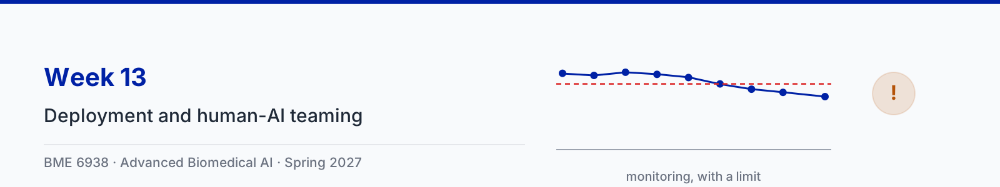

# Week 13: Deployment, human-AI teaming, and ambient intelligence

| Session | Content |
|---|---|
| Tue Apr 6 | Deployment, human-AI teaming, and ambient intelligence, with three animation clips |
| Thu Apr 8 | Paper sessions: [Wong et al., External Validation of a Widely Implemented Proprietary Sepsis Prediction Model in Hospitalized Patients](https://doi.org/10.1001/jamainternmed.2021.2626) and [Haque et al., Illuminating the dark spaces of healthcare with ambient intelligence](https://doi.org/10.1038/s41586-020-2669-y) |

Slides: [13-1 slides (PDF)](slides/13-1-deployment-and-human-ai-teaming.pdf)

## Animation clips

The Wong numbers in clip 1 and the two sensing studies in clip 3 were checked against the papers. The three operating
points in clip 2, the monitoring chart, and the clinician and model sensitivities in clip 3 are illustrative and marked
as such on screen. The alert loads in clip 2 and the 100-case grids in clip 3 are computed in the scene files from the
stated sensitivities, so the numbers on screen cannot drift from the arithmetic. Each clip comes in two versions:
narrated (voice-over plus on-screen captions) and silent (captions only).

| Clip | Narrated | Silent |
|---|---|---|
| 1. What external validation found | [2 min 4 s](clips/narrated/week13-clip1-external-narrated.mp4) | [52 s](clips/silent/week13-clip1-external.mp4) |
| 2. Thresholds, alert burden, and drift | [1 min 42 s](clips/narrated/week13-clip2-thresholds-narrated.mp4) | [47 s](clips/silent/week13-clip2-thresholds.mp4) |
| 3. Humans and models together | [2 min 28 s](clips/narrated/week13-clip3-teaming-narrated.mp4) | [55 s](clips/silent/week13-clip3-teaming.mp4) |

The narration is an AI-generated voice reading a script written for the course. Captions for the narrated clips are in
a WebVTT file beside each video (`clips/narrated/*.vtt`), which covers WCAG 2.1 criterion 1.2.2; players that read
sidecar subtitle files, such as VLC, load them automatically. The source code for the clips is in
[animations/](animations/) and the narration script is in [clips.json](clips.json). The storyboard brief is in
[storyboard.md](storyboard.md).

**Note for the lecture (clip 1): the comparison that matters is current practice.** The headline numbers are an AUC of
0.63 against the vendor's 0.76 to 0.83, sensitivity of 33% at the recommended threshold, and alerts on 18% of
hospitalizations. The sharper finding is further down: of 2,552 sepsis cases, 1,709 were never flagged and 1,030 of those
patients received timely antibiotics anyway, while only 183 cases, 7% of the total, were flagged at a point where
antibiotics had not already been given in time. A model that scores above chance can still add almost nothing to what
clinicians are already doing. The clip gives that its own segment.

**Note for the lecture (clip 1): the authors answer the obvious objection.** Computing the AUC separately at each time
horizon gives 0.72 to 0.76, which is much closer to the vendor's range. Wong et al. report those figures and explain why
they are misleading, because the predictions at successive horizons are not independent of each other, and calibration
was poor at every horizon. Worth raising in the paper session before a student raises it.

**Note for the lecture (clip 1): the paper carries a correction.** The article was corrected on 2 August 2021 to fix an
error in the number needed to evaluate in Table 2 and the Results. For a lecture about evaluation this is worth a minute:
the authors found and published an error in the very statistic the paper is best known for, which is what the process is
supposed to do.

**Note for the lecture (clip 3): the ambient intelligence numbers come from the primary studies.** Haque et al. is a
review, so clip 3 cites it for what ambient intelligence is and for the barriers it names (rigorous clinical validation,
data privacy, model transparency), and takes the measured results from the studies themselves: hand hygiene from
[Singh et al., JAMIA 2020](https://doi.org/10.1093/jamia/ocaa115) and ICU mobility from
[Yeung et al., npj Digital Medicine 2019](https://doi.org/10.1038/s41746-019-0087-z). The two weak numbers are the
teaching: the hand-hygiene result rests on a test set of 88 dispenser-use events, and the ICU system detects a mobility
event 87% of the time but counts how many staff were involved correctly only 69% of the time.

## Transcripts

Each clip also has a plain-text transcript of its narration in [clips/transcripts/](clips/transcripts/). The
transcript is the text alternative for the silent version, which has no audio track at all (WCAG 2.1 criterion 1.2.1),
and it is the quickest way to review what a clip says when revising.

| Clip | Transcript |
|---|---|
| 1. What external validation found | [week13-clip1-external.md](clips/transcripts/week13-clip1-external.md) |
| 2. Thresholds, alert burden, and drift | [week13-clip2-thresholds.md](clips/transcripts/week13-clip2-thresholds.md) |
| 3. Humans and models together | [week13-clip3-teaming.md](clips/transcripts/week13-clip3-teaming.md) |

## Notebook

The ungraded reference notebook for this lecture is [week13_deployment.ipynb](../notebooks/week13_deployment.ipynb). It
covers what happens after a model is trained, and two of its four results are less comfortable than the clips. The
figures are in the notebook rather than repeated here, so there is one copy to keep true.

**Thresholds.** A synthetic risk score at 7% prevalence, with an AUC deliberately better than the deployed model's
0.63. Sweeping the threshold trades sensitivity against positive predictive value and alert volume, and the notebook
compares the number needed to evaluate at that operating point with what Wong et al. report for the real model. A
substantially better model lands in the same place, because at 7% prevalence the positive predictive value is governed
by how rare the outcome is rather than by discrimination.

**Drift.** Eighteen months, 2,000 hospitalizations each, with a drift starting in month 10 and control limits set from
the first nine months. The three-sigma rule fires months after the drift begins; a run of consecutive months below the
centre line fires earlier. Monitoring converts a slow drift into a dated signal and still leaves months of exposure,
and the notebook says so.

**Teaming.** The clinician at 0.80 and the model at 0.75 from clip 3, with the correlation between their errors swept
from 0 to nearly 1. "Flag if either flags" falls towards the clinician working alone, while "flag only if both flag"
rises. The simulation reproduces both closed forms exactly, and the whole result lives in a quantity that cannot be
computed from the two sensitivities.

**The 88-event test set.** A paired bootstrap reconstructing the hand-hygiene comparison recovers intervals close to
the published ones, and a difference whose lower end sits at zero. The published claim is not wrong and it is not firm
either.

It needs no downloads.

## Further reading

- Wong et al., [External Validation of a Widely Implemented Proprietary Sepsis Prediction Model in Hospitalized Patients](https://doi.org/10.1001/jamainternmed.2021.2626), JAMA Internal Medicine, 2021 ([free full text](https://pmc.ncbi.nlm.nih.gov/articles/PMC8218233/))
- Haque et al., [Illuminating the dark spaces of healthcare with ambient intelligence](https://doi.org/10.1038/s41586-020-2669-y), Nature, 2020
- Singh et al., [Automatic detection of hand hygiene using computer vision technology](https://doi.org/10.1093/jamia/ocaa115), JAMIA, 2020 ([free full text](https://pmc.ncbi.nlm.nih.gov/articles/PMC7481030/))
- Yeung et al., [A computer vision system for deep learning-based detection of patient mobilization activities in the ICU](https://doi.org/10.1038/s41746-019-0087-z), npj Digital Medicine, 2019
- Sendak et al., [Real-World Integration of a Sepsis Deep Learning Technology Into Routine Clinical Care](https://doi.org/10.2196/15182), JMIR Medical Informatics, 2020
- Martinez-Martin et al., [Ethical issues in using ambient intelligence in health-care settings](https://doi.org/10.1016/S2589-7500(20)30275-2), The Lancet Digital Health, 2021
